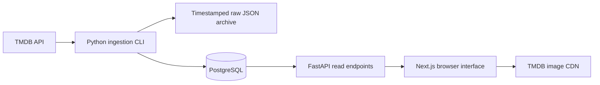

# CineMetrics Study Guide and Project Reviewer

CineMetrics collects movie data from TMDB, stores daily observations in PostgreSQL, and presents rankings and trends through a website. Use this guide to understand the implementation, practice explaining your decisions, and prepare for a portfolio interview or project defense.

Read the [README](../README.md) for full installation and deployment instructions. The [verification record](../VERIFICATION.md) documents completed checks and their limits. This guide explains the current implementation; features under Future improvements are proposals.

## Project overview

**Problem:** Current movie scores alone do not explain how interest changes over time. CineMetrics keeps daily observations so users can compare popularity across collection dates.

**Users:** Movie enthusiasts exploring titles and students learning how a web application handles external data.

**Core features:** A database-backed dashboard, title search, genre/year/vote filters, sorting, pagination, movie detail pages, historical charts, and rising-movie rankings.

**Coverage:** The app collects configurable pages from TMDB's popular-movies endpoint. It does not contain the complete TMDB catalog. The initial verified live run stored 96 distinct movies from five requested pages; that is a recorded result, not a permanent movie count or a guarantee that five pages always yield 100 unique titles.

**Current search limitation:** Searching for Iron Man only succeeds if a matching title is already stored. TMDB-wide search and written movie reviews are not implemented.

## A short explanation to practice

> CineMetrics is a movie popularity tracker built with Next.js, FastAPI, and PostgreSQL. A private Python command fetches TMDB movie data, archives the responses, validates the records, and stores one observation per movie per UTC day. The website queries our database to display rankings, filters, and historical trends. TMDB popularity is a provider-specific score, and the app only claims coverage of the movies it has collected.

Rewrite this in your own words. Be prepared to point to the code behind each sentence.

## Architecture and data flow



The application has two distinct flows:

1. **Collection:** A CLI process calls TMDB and writes validated data to PostgreSQL. This happens when the command runs. A cron configuration is documented, but a recurring job has not been installed by the application.
2. **Browsing:** The browser requests FastAPI endpoints, and FastAPI reads the database. Browsing and searching do not trigger ingestion or call TMDB's catalog search.

Posters load from TMDB's image CDN using URLs assembled during ingestion. Scores and metadata come through the application's stored dataset.

### Technology responsibilities

| Technology | Responsibility in CineMetrics |
| --- | --- |
| Next.js and React | Routes, page structure, interactive components, and navigation |
| TypeScript | Checks frontend data shapes and code at development/build time |
| Tailwind CSS and custom CSS | Styling, responsive layout, focus states, and dark theme |
| FastAPI | HTTP endpoints and query parameter validation |
| SQLAlchemy | Database models, bound SQL queries, sessions, and transactions |
| PostgreSQL | Persistent relational data, constraints, and daily upserts |
| Alembic | Versioned database schema changes |
| HTTPX | Server-side requests to TMDB with explicit timeouts |
| Recharts | Popularity and rating charts |
| Docker Compose | Runs the frontend, backend, and database together |
| pytest | Transformation, query, ingestion, and database tests |

A REST endpoint is a URL that exposes a resource over HTTP. An ORM maps Python models to database tables. A migration is a versioned change to that database structure.

TypeScript does not validate incoming JSON at runtime. The ingestion transformer and API query validation cover specific inputs; the frontend's TypeScript types describe the response it expects.

## Source files to learn first

Paths below are relative to the repository root.

| File | What to study |
| --- | --- |
| `backend/app/models.py` | The five tables, relationships, keys, and constraints |
| `backend/app/ingest.py` | Fetching, transformation, retries, raw archives, and upserts |
| `backend/app/main.py` | Filtering, pagination, summaries, and rising calculations |
| `backend/app/db.py` | Engine, database sessions, and request dependency |
| `backend/app/config.py` | Environment-based settings and cached configuration |
| `backend/migrations/versions/001_initial.py` | Initial schema migration, independent of later model edits |
| `backend/tests/test_app.py` | Expected behavior and test-only fixtures |
| `frontend/components/Browse.tsx` | Search/filter state and API requests |
| `frontend/components/data.ts` | Response types, API URL, fetch helper, and missing-value formatting |
| `frontend/components/Card.tsx` | Movie cards and links to TMDB-ID detail routes |
| `frontend/components/Poster.tsx` | Fallback when a poster is missing or fails to load |
| `frontend/app/movies/[id]/page.tsx` | Details, stored history, charts, and observation tables |
| `frontend/app/layout.tsx` | Shared navigation, metadata, and TMDB credits |
| `compose.yaml` | Service connections, environment variables, health checks, and volumes |

Suggested reading order: models → ingestion → API → frontend data helper → Browse → movie details → tests. Follow one movie through these files before trying to memorize the whole project.

## Database design

### Tables and relationships

| Table | Purpose | Key |
| --- | --- | --- |
| `movies` | Current title, overview, poster URL, release date, and language | TMDB movie ID |
| `genres` | Genre identifiers and names | TMDB genre ID |
| `movie_genres` | Links movies with their genres | Movie ID + genre ID |
| `movie_snapshots` | Daily popularity, rating, vote count, and collection time | Movie ID + UTC day |
| `pipeline_runs` | Collection start/end, status, count, and sanitized failure information | Run ID |

A movie has many snapshots. A movie can have several genres, and one genre can belong to many movies, so `movie_genres` implements a many-to-many relationship. Foreign keys prevent associations or snapshots from referring to nonexistent parent records.

Metadata and observations are separated because their purposes differ. The title and overview represent current descriptive information; each snapshot preserves metrics for one collection day. The app does not retain historical versions of every metadata field.

### Daily uniqueness and upserts

The composite primary key `(movie_id, day)` prevents two snapshots for the same movie on the same UTC day. An **upsert** inserts a new row or updates the conflicting row through PostgreSQL's `ON CONFLICT DO UPDATE`.

If a movie has popularity 80 during a morning run and 85 during an evening run on the same UTC day, the stored snapshot becomes 85. There is still one row for that day. The previous day's row remains unchanged. This means CineMetrics preserves daily history, not every intraday movement.

This is idempotent with respect to row identity and count: a rerun does not duplicate daily observations. Values can still change when TMDB's current response changes.

### Indexes and their limits

Indexes cover movie titles, release dates, snapshot dates, genre links, and pipeline status. They help suitable queries locate rows efficiently. However, the current title search uses a leading wildcard (`%term%`); a normal title index does not generally accelerate that pattern well. PostgreSQL trigram indexing would be a possible improvement if the dataset becomes large.

## Ingestion step by step

Run from the repository root:

```sh
docker compose run --rm backend python -m app.ingest --pages 5
```

The CLI:

1. Loads configuration and requires a Read Access Token.
2. Acquires a PostgreSQL advisory lock so another ingestion cannot run concurrently.
3. Creates a `pipeline_runs` row with status `running`.
4. Fetches TMDB image configuration, genre mappings, popular pages, and each listed movie's details.
5. Archives successful JSON responses in a folder named with a UTC timestamp and UUID.
6. Excludes adult titles and deduplicates records by movie ID in memory.
7. Validates movie identity, dates, and numeric metrics.
8. Upserts metadata, genre links, and snapshots inside one database transaction.
9. Marks the run successful in that transaction, or records a failed run separately if processing fails.

A **transaction** groups database changes so they commit together. If a record fails validation, movie changes from the batch roll back. Previously committed data remains available. Raw files already archived remain on disk for diagnosis.

### Handling unreliable requests

Requests have a 20-second timeout and a maximum of five attempts. Transport errors use exponential backoff. HTTP 429 and server errors are retried; the client honors a numeric `Retry-After` value when supplied, with each wait capped at 60 seconds. Most other non-200 responses fail immediately.

The CLI avoids storing authorization headers in raw files and avoids logging credential-bearing exception text. Its run record stores a sanitized failure description. If the process is abruptly killed, a `running` status can remain and needs investigation.

### Validation and missing data

A numeric metric must be finite and nonnegative; rating must also be at most 10, and vote count must be an integer. Missing metrics remain `None` in Python, `NULL` in PostgreSQL, and `null` in JSON.

Zero and missing are different. A reported rating of zero remains zero; an absent rating remains missing. The frontend displays missing values as an em dash.

## API behavior

Open interactive documentation at http://localhost:8000/docs.

| GET endpoint | Purpose |
| --- | --- |
| `/health` | Checks database connectivity and snapshot-table availability |
| `/genres` | Returns stored genre options |
| `/movies` | Lists stored movies with search, filters, sorting, and pagination |
| `/movies/{movie_id}` | Returns a collected movie and its latest observation |
| `/movies/{movie_id}/history` | Returns that movie's stored daily observations in date order |
| `/summary` | Returns dataset counts, averages, vote total, date range, and refresh time |
| `/rising` | Compares shared movies on the newest two collection dates |

Example:

```text
GET /movies?q=Inception&year=2010&min_votes=100&sort=rating&page=1&page_size=12
```

Filters combine using AND: a returned movie must satisfy all selected conditions. The default page size is 12 and the maximum is 60. Page numbers start at 1. Sorting is descending, with missing values last and movie ID as a stable tiebreaker.

For page 3 with 12 items per page:

```text
OFFSET = (3 - 1) × 12 = 24
LIMIT = 12
```

The count query determines the number of matching movies before pagination. The UI calculates total pages as `ceil(total / page_size)`.

Invalid query parameters produce HTTP 422. Uncollected movie details/history return 404. Database errors return 503. `/health` confirms database/schema readiness; it does not prove that TMDB is reachable or that stored data is recent.

SQLAlchemy binds values rather than building SQL from untrusted strings. Sort fields come from an allowlist, and title-search wildcard characters are escaped.

## Frontend behavior

`Browse.tsx` holds search text, filters, sorting, page number, loading status, and results in React state. An effect fetches the relevant API response after a 250-millisecond delay. The timer reduces requests during typing; `AbortController` cancels an obsolete browser request when inputs change or the component unmounts. Changing a filter resets the page to 1.

The frontend displays loading placeholders, errors with retry controls, honest empty states, and a poster fallback. Movie links use TMDB IDs, such as `/movies/27205`, so the detail URL is shareable and unambiguous.

The detail page fetches metadata and history. It shows charts only after at least two stored observations exist. Rating and popularity use separate charts because they have different scales. Observation tables provide exact values alongside the charts.

## Metrics and calculations

### Latest observations

Listings and summary statistics use each movie's latest stored snapshot. This is a separate latest date per movie, not necessarily one shared date for the entire dataset. A title that leaves the fetched popular pages remains stored, and its metrics can become stale.

`last_refresh` is the finish time of the newest successful pipeline run. It does not mean every movie was refreshed during that run.

### Summary calculations

| Metric | Calculation |
| --- | --- |
| Movies tracked | Count of collected movies with snapshots |
| Average rating | Arithmetic mean of non-null latest ratings |
| Average popularity | Arithmetic mean of non-null latest popularity scores |
| Votes recorded | Sum of non-null latest vote counts |

These averages are unweighted: a movie with 100 votes contributes one rating value, just as a movie with 10,000 votes does. If there are no available metric values, the aggregate stays missing; the app does not invent a zero.

**Illustrative example, not stored project data:** Latest ratings of 8, 6, and missing produce `(8 + 6) / 2 = 7`. The missing score is excluded from the denominator.

TMDB popularity is its own score. Do not describe it as views, audience size, revenue, or CineMetrics' own prediction. Ratings and vote counts also come from TMDB.

### Rising movies

The API finds the latest two distinct dates in the snapshot table, then compares only movies present on both dates with usable popularity values.

```text
absolute change = newer popularity − older popularity
percentage change = absolute change / older popularity × 100
```

**Illustrative example:** A change from 80 to 100 is +20, or +25%. The ranking sorts positive absolute changes, not percentage changes. A zero baseline produces no percentage value because division by zero is undefined.

Newly collected movies have no baseline and are excluded. If collection dates are several days apart, the result compares those dates; it is not necessarily a 24-hour change. With fewer than two dates, the app shows an explanatory empty state.

### UTC and history

The app assigns snapshots to the UTC date at ingestion start. In Manila, a run shortly after midnight can still belong to the previous UTC date. This keeps daily uniqueness independent of the viewer's time zone.

History begins with collection. Today's TMDB response cannot reconstruct this application's observations from last month. Missing scores are not converted to zero, and chart lines do not connect across null metric values.

## Local operation and troubleshooting

From the repository root:

```sh
# Start services using the existing local configuration.
docker compose up -d

# Apply migrations after an applicable schema release.
docker compose run --rm backend alembic upgrade head

# Collect or refresh the selected popular pages.
docker compose run --rm backend python -m app.ingest --pages 5

# Check running services and backend logs.
docker compose ps
docker compose logs --tail 50 backend

# Stop services while preserving named volumes.
docker compose down
```

The frontend uses port 3000, the API uses 8000, and this project's local PostgreSQL binding uses 5433 because 5432 was occupied during setup. Containers connect to the database internally at `db:5432`.

The `postgres_data` volume holds the database, and `raw_data` holds response archives. `docker compose down -v` deletes these volumes and their data; it is not the ordinary shutdown command.

| Symptom | Explanation or next check |
| --- | --- |
| A movie cannot be found | Check whether it was collected; search is local to the database |
| Empty dashboard | Check `/health`, migrations, and whether ingestion succeeded |
| Missing charts or rising movies | Check for snapshots on at least two UTC dates |
| Browser cannot fetch data | Check backend availability, browser API URL, and exact CORS origin |
| New API URL has no effect | Rebuild the frontend because `NEXT_PUBLIC_API_URL` is embedded at build time |
| Ingestion fails | Check token validity, connectivity, pipeline status, and archived responses |
| Movie count is below pages × 20 | Pages may overlap, end early, or include excluded records |

Root `.env` configures Docker Compose. Native backend development reads `backend/.env`, and native frontend development normally uses `frontend/.env.local`. Keep real values out of source control and presentations.

## Security and deployment concepts

The TMDB token stays on the server. `NEXT_PUBLIC_API_URL` is a public address, not a place for credentials. CORS tells browsers which origins may access API responses; it is not authentication and does not prevent non-browser clients from making requests.

The API has no ingestion endpoint. Collection runs through the CLI or a private job so a visitor cannot trigger a costly database update. Production also needs HTTPS, exact CORS origins, durable database/raw storage, backups, and a scheduler.

The repository documents a cron option, but the scheduler must be installed separately. Before publishing, rotate credentials previously shared in chat, configure production secrets, and verify the public URLs. Nothing in the current project automatically purchases hosting or publishes the site.

## Tests and evidence

Run the backend tests in a prepared native environment:

```sh
cd backend
.venv/bin/python -m pytest -q
```

Two PostgreSQL integration tests require `TEST_DATABASE_URL` pointing to a separate disposable test database. Without it they are skipped. See the README for database creation and the exact command. Never point integration tests at production.

Frontend checks:

```sh
cd frontend
npm run typecheck
npm run build
```

The recorded implementation checks include 13 passing backend tests with PostgreSQL integration enabled, frontend checks/builds, application Docker builds, migrations, and live TMDB collection. A same-day live rerun left 96 movies and 96 daily snapshots with zero duplicate groups. Live API filtering/pagination and browser search/detail loading were checked.

A one-day dataset does not demonstrate the actual multi-day chart or a live rising gain. Those still require collection on later UTC dates. Automated fixture-based trend tests verify the calculation, not a history the application has not collected.

## Interview and defense questions

Practice each answer, then find the supporting implementation.

| Question | Answer to develop |
| --- | --- |
| Why use a database instead of fetching TMDB on every page load? | It preserves observations, supports repeatable local queries, and decouples browsing from collection. Data freshness depends on ingestion. |
| Why separate movies and snapshots? | Metadata describes the movie; snapshots preserve time-dependent metrics. |
| What prevents duplicate observations? | The composite movie/day primary key and PostgreSQL upsert. |
| What happens when ingestion fails halfway through? | The movie transaction rolls back, the failure is recorded separately, and archived responses remain. |
| What prevents two ingestion jobs from overlapping? | A PostgreSQL advisory lock held by the collection process. |
| Why can Iron Man be missing? | The popular-page collection is a subset; the current search does not query all of TMDB. |
| How do you identify rising movies fairly? | Compare shared movie IDs on the same two collection dates, exclude missing scores and new titles, then sort positive absolute changes. |
| What does a missing score mean? | No usable reported value; it is not zero. |
| Are your ratings vote-weighted? | No. Dashboard averages are unweighted means of non-null latest observations. |
| What does a healthy API prove? | Database/schema access, not dataset freshness or upstream TMDB availability. |
| How are secrets protected? | Server-side environment settings, ignored local files, no public token variables, and sanitized logs. |
| How would you scale search? | Measure first, then consider trigram indexing, caching, or a separate TMDB catalog search flow. |
| What did you personally contribute? | Describe only decisions, debugging, explanations, and modifications you actually made; acknowledge AI assistance honestly. |

## A practical demo sequence

1. Start Docker and show the health checks.
2. Open the dashboard and explain the dataset count and latest-refresh timestamp.
3. Search for a known collected title such as Inception, if still present in your database.
4. Change a genre or vote filter and explain that the filtering happens in the backend query.
5. Clear the filters and demonstrate pagination.
6. Open a movie URL and explain metadata versus its latest snapshot.
7. Show charts if history exists; otherwise explain the honest one-day state.
8. Show the composite snapshot key and the test that checks same-day upserts.
9. Describe the search limitation and one planned improvement without claiming it is already implemented.

## Practice exercises

1. Trace how typing a title becomes the `q` parameter, a SQL condition, and movie cards.
2. Explain why rerunning ingestion today cannot create yesterday's history.
3. Use a test-only fixture with a newly collected movie and show why it is excluded from rising results.
4. Calculate an unweighted average with one missing rating, then compare it with a vote-weighted calculation.
5. Explain why a successful refresh can coexist with an older snapshot for a movie no longer on fetched popular pages.
6. Inspect `pipeline_runs` and describe the difference between `running`, `success`, and `failed`.
7. Sketch a TMDB-wide search design that labels external results separately from stored observations and keeps credentials on the server.

## Future improvements

These are not current features:

- TMDB-wide movie search with clear coverage labels and a controlled way to begin tracking a selected movie.
- A refresh strategy for previously tracked titles that fall outside the popular pages.
- An installed daily job with failure monitoring and backup/restore checks.
- A public deployment with configured HTTPS and production origins.
- More browser coverage for populated filters, pagination, accessibility, and multi-day history.

The most useful next step for portfolio preparation is to explain one complete request and one complete ingestion run without reading a script, then make and test a small change yourself.
